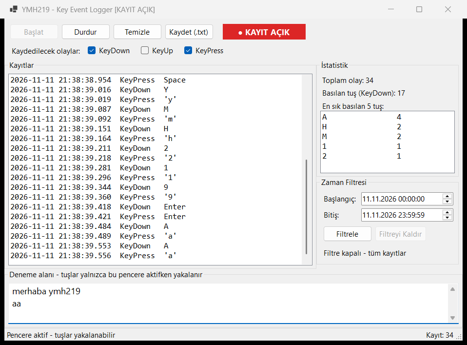

# YMH219 - Key Event Logger

Nesne Tabanlı Programlama (YMH 219) dersi için Windows Forms ile yazılmış eğitsel klavye olay kaydedici. Yalnızca uygulama penceresi odaktayken `KeyDown`, `KeyUp` ve `KeyPress` olaylarını listeler; istenirse `.txt` dosyasına kaydeder.

## Güvenlik notu

Bu bir sistem keylogger’ı değildir. Global hook yoktur; başka uygulamalardan tuş toplanmaz, ağ üzerinden veri gönderilmez. Kayıt yalnızca kullanıcı Kaydet düğmesine basınca seçilen yerel dosyaya yazılır.

## Kullanılan teknolojiler

- C# / .NET 9 (`net9.0-windows`)
- Windows Forms
- `StreamWriter` (UTF-8)
- Harici NuGet paketi yok

## Çalıştırma

```bash
git clone https://github.com/kubradmrgc/YMH219-KeyEventLogger.git
cd YMH219-KeyEventLogger
dotnet run --project YMH219-KeyEventLogger
```

## Kullanım

1. Başlat ile kaydı açın.
2. Deneme alanına yazın; olaylar listeye eklenir.
3. İsterseniz olay türü seçin, filtreleyin, istatistiğe bakın.
4. Kaydet (.txt) ile dosyaya yazın.

## Özellikler

- Tuş adı, olay türü, Ctrl/Shift/Alt ve zaman bilgisi
- Başlat / Durdur / Temizle
- İstatistik (toplam ve en sık tuşlar)
- Tarih/saat aralığı filtresi

## Ekran görüntüleri

| Kayıt | Filtre |
| --- | --- |
|  |  |

## Öğrenci

- Ad Soyad: Kübra Demirgüç
- Öğrenci No: 230541115
