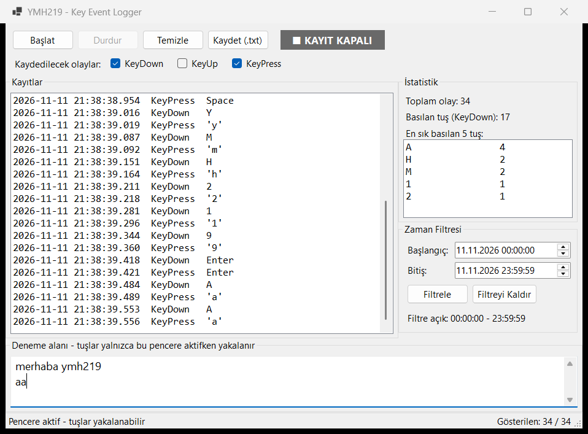

# YMH219 - Key Event Logger

Nesne Tabanlı Programlama (YMH 219) dersi için Windows Forms ile geliştirilen **eğitsel** klavye olay kaydedici. Uygulama, yalnızca kendi penceresi aktifken oluşan `KeyDown`, `KeyUp` ve `KeyPress` olaylarını tuş adı ve zaman bilgisiyle listeler. Kullanıcı isterse kayıtlar yerel bir `.txt` dosyasına kaydedilir.

## Kapsam ve Güvenlik Sınırı

Bu uygulama gerçek bir sistem keylogger'ı **değildir**:

- Tuşlar yalnızca formun `KeyPreview` özelliği ile, uygulama penceresi odaktayken yakalanır.
- Global keyboard hook, gizli/arka plan çalışma veya başlangıçta otomatik çalışma yoktur.
- Başka uygulamalardan veri toplanmaz, kayıtlar ağ üzerinden gönderilmez.
- Kayıtlar yalnızca kullanıcı **Kaydet** düğmesine bastığında, seçtiği yerel dosyaya yazılır.
- Pencere odakta değilken durum çubuğu "tuşlar yakalanmıyor" bilgisini gösterir.

## Kullanılan Teknolojiler

- C# / .NET 9 (`net9.0-windows`)
- Windows Forms (`Form`, `Button`, `CheckBox`, `ListBox`, `TextBox`, `DateTimePicker`, `StatusStrip`, `SaveFileDialog`, `MessageBox`)
- Klavye olayları: `KeyDown`, `KeyUp`, `KeyPress`
- Dosya işlemleri: `StreamWriter` (UTF-8)
- Harici NuGet paketi kullanılmaz

## Kurulum ve Çalıştırma

1. Windows üzerinde [.NET 9 SDK](https://dotnet.microsoft.com/download) kurulu olmalıdır.
2. Depoyu klonlayın:
   ```bash
   git clone https://github.com/kubradmrgc/YMH219-KeyEventLogger.git
   cd YMH219-KeyEventLogger
   ```
3. Uygulamayı çalıştırın:
   ```bash
   dotnet run --project YMH219-KeyEventLogger
   ```
   Alternatif olarak `YMH219-KeyEventLogger.sln` dosyasını Visual Studio 2022 ile açıp **F5** ile başlatabilirsiniz.

## Kullanım

1. **Başlat** ile kaydı açın; gösterge kırmızı "KAYIT AÇIK" olur.
2. Deneme alanına yazın; her olay zaman bilgisiyle listeye eklenir.
3. "Kaydedilecek olaylar" kutularından `KeyDown`, `KeyUp`, `KeyPress` seçimini yapın.
4. **Durdur** ile kaydı kapatın, **Temizle** ile listeyi silin.
5. **Kaydet (.txt)** ile listedeki kayıtları dosyaya yazın.
6. Zaman Filtresi bölümünde başlangıç/bitiş seçip **Filtrele** ile yalnızca o aralıktaki kayıtları gösterin.

## Temel Özellikler

- Tuş adı, olay türü, değiştirici tuşlar (Ctrl/Shift/Alt) ve milisaniyeli zaman bilgisi
- Başlat / Durdur / Temizle ve açık kayıt durumu göstergesi (renkli etiket + pencere başlığı)
- Olay türü seçimi (KeyDown, KeyUp, KeyPress)
- `.txt` dosyasına kaydetme; dosya yazılamazsa hata mesajı
- İstatistik: toplam olay, basılan tuş sayısı, en sık basılan 5 tuş
- Tarih/saat aralığına göre filtreleme; istatistik ve kaydetme filtrelenmiş listeye göre çalışır

## Sınıf Yapısı

| Sınıf | Görev |
| --- | --- |
| `MainForm` | Arayüz, klavye olayları, düğmeler, filtre ve istatistik gösterimi |
| `KeyEventRecorder` | Kayıt durumu (başlat/durdur), olay türü seçimi, kayıt listesi ve olaylar |
| `KeyLogEntry` | Tek bir olayın zamanı, türü, tuş adı ve değiştiricileri |
| `KeyStatistics` | Toplam sayılar ve en sık basılan tuşlar |
| `KeyLogFilter` | Zaman aralığına göre süzme |
| `LogFileWriter` | Kayıtları `StreamWriter` ile dosyaya yazma |

## Ekran Görüntüleri

| Kayıt sırasında | Kayıt durdurulmuş, filtre açık |
| --- | --- |
|  |  |

## Bilinen Sınırlamalar / Geliştirme Notları

- Yalnızca Windows'ta çalışır (Windows Forms).
- `Tab` gibi bazı gezinme tuşları, odak deneme alanı dışındaki bir kontroldeyken form tarafından işlenebilir; en doğru sonuç için deneme alanına yazılmalıdır.
- Filtre saniye hassasiyetindedir.

## Öğrenci

- Ad Soyad: Kübra Demirgüç
- Öğrenci No: 230541115
